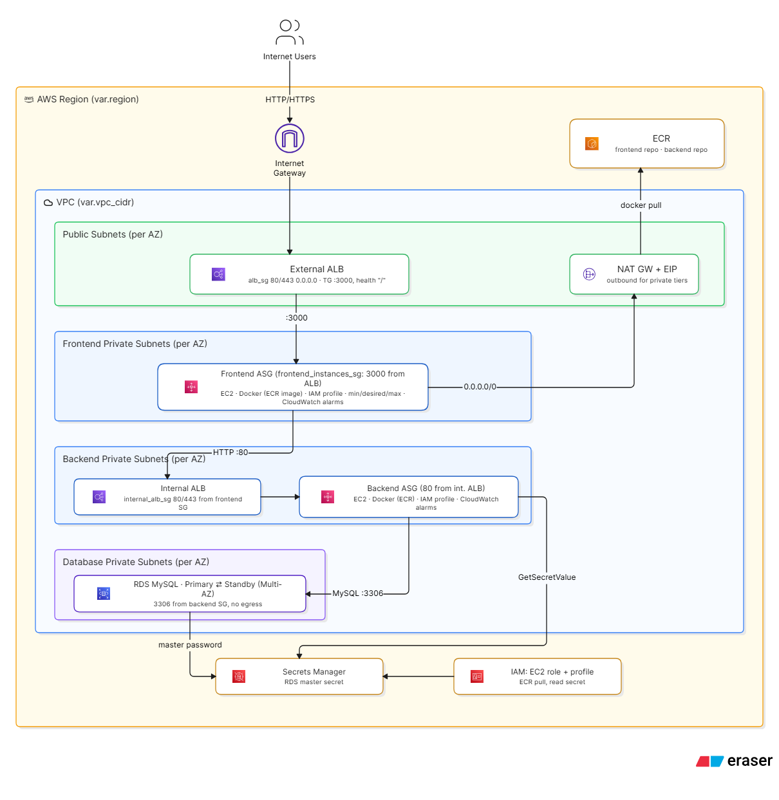

# Terraform 3-Tier Architecture on AWS

A goal-tracking web application deployed to AWS as a classic three-tier system: presentation, logic and data, each isolated in its own private network tier. The whole stack is defined in Terraform and ships from a single command.

The application itself is deliberately simple. The point of this project is the infrastructure around it: how code becomes a container image, how that image reaches private servers without credentials, how releases roll out without downtime, and how the stack stays secure and reproducible.

## What this project solves

Most first deployments put the app, the database and SSH access on one public server. That works until it doesn't: one compromised port exposes everything, one failed instance takes the site down, and nobody can say which version is running.

This project addresses each of those problems:

| Problem | How it's solved here |
|---|---|
| Single point of failure | Every tier runs across two Availability Zones behind load balancers |
| Servers exposed to the internet | Only the public load balancer is reachable; all instances and the database sit in private subnets |
| Credentials stored in code or on disk | Image pulls, secret reads and log shipping all use the instance's IAM role; the database password is generated and held by AWS |
| "Works on my machine" deployments | The same container image runs locally and in AWS, built for the target CPU architecture |
| Unknown or drifting versions | Every image is tagged with its git commit and tags can't be overwritten |
| Manual, risky releases | A new tag triggers a rolling instance refresh; unhealthy instances are replaced automatically |
| No visibility once deployed | Application and bootstrap logs stream to CloudWatch with instance-level metrics |

## Architecture



### Request path

1. A user's request reaches the **external Application Load Balancer** in the public subnets.
2. The ALB forwards it to a **frontend instance** in a private subnet. The frontend serves the UI and proxies API calls.
3. API calls go to the **internal ALB**, which is not reachable from the internet.
4. The internal ALB forwards to a **backend instance**, which reads and writes **RDS PostgreSQL**.

### Network isolation

Each tier only accepts traffic from the tier directly above it. Rules reference security groups rather than IP ranges, so they keep working as instances come and go.

| Security group | Accepts | From |
|---|---|---|
| External ALB | 80 | Internet |
| Frontend | 3000 | External ALB |
| Internal ALB | 80 | Frontend |
| Backend | 8080 | Internal ALB |
| RDS | 5432 | Backend |

No security group allows SSH. Administrative access goes through SSM Session Manager.

## How a release works

```
 git commit
     │
     ▼
 deploy.sh ──► terraform apply -target=module.ecr     ECR repositories exist
     │
     ▼
 build-and-push.sh ──► docker build --platform linux/amd64
     │                 docker push  <repo>:<git-sha>   Images stored in ECR
     ▼
 image_tag.auto.tfvars ◄── image_tag = "<git-sha>"     Release pinned
     │
     ▼
 terraform apply ──► launch template changes ──► ASG instance refresh
                                                     │
                                                     ▼
                              new instance boots, user_data runs:
                              ECR login via IAM role → read DB secret →
                              docker pull → docker run → health check passes
                                                     │
                                                     ▼
                              old instance drained and terminated
```

The ECR repositories are created first because they must exist before images can be pushed, and images must exist before instances boot. Every later release skips straight to build and push.

## Repository structure

```
.
├── backend/                      API source and Dockerfile
├── frontend/                     UI source and Dockerfile
├── docker-local-deployment/
│   ├── docker-compose.yml        Full stack locally, with Postgres
│   └── database/init.sql
└── terraform-infra/
    ├── environments/dev/         Root module: wires the modules together
    │   ├── main.tf
    │   ├── variables.tf          Deployment settings only
    │   ├── locals.tf             Shared name prefix and tags
    │   ├── outputs.tf
    │   └── image_tag.auto.tfvars Written by deploy.sh, records the live release
    ├── modules/
    │   ├── vpc/                  VPC, subnets per tier, NAT, routing
    │   ├── security-groups/      Tier-to-tier access rules
    │   ├── ecr/                  Image repositories, scanning, lifecycle
    │   ├── rds/                  PostgreSQL with RDS-managed credentials
    │   ├── iam/                  Instance role and profile
    │   ├── alb/                  Reused for both external and internal ALBs
    │   ├── frontend-asg/         Launch template, ASG, bootstrap script
    │   └── backend-asg/          Launch template, ASG, bootstrap script
    └── scripts/
        ├── deploy.sh             End-to-end deploy
        └── build-and-push.sh     Build images and push to ECR
```

## Getting started

### Prerequisites

- AWS CLI v2, configured with credentials (`aws sts get-caller-identity` must succeed)
- Terraform 1.5 or later
- Docker, running
- Git
- On Windows, run the scripts from Git Bash or WSL

### Run locally

```bash
cd docker-local-deployment
docker compose up --build
```

Open http://localhost:3000. Compose builds both images from source and starts a local Postgres. Nothing touches AWS.

### Deploy to AWS

Commit your work first. The script tags images with the commit SHA and refuses to deploy uncommitted changes, so every running image maps to exact source.

```bash
git add -A && git commit -m "Your change"
./terraform-infra/scripts/deploy.sh
```

The script shows the Terraform plan and waits for you to type `yes`. When it finishes, it prints the application URL. Instances take roughly 5 to 10 minutes to boot and pass health checks.

Commit the pinned release afterwards:

```bash
git add terraform-infra/environments/dev/image_tag.auto.tfvars
git commit -m "Release $(git rev-parse --short HEAD)"
```

### Release a new version

Change code, commit, and run `deploy.sh` again. The new tag changes both launch templates, and the Auto Scaling Groups replace instances in batches while the load balancers keep serving traffic.

### Run the deployed images locally

To test the exact images running in AWS rather than a fresh build:

```bash
cd terraform-infra/environments/dev
REGION=$(terraform output -raw region)
BACKEND_REPO=$(terraform output -raw backend_ecr_repository_url)
FRONTEND_REPO=$(terraform output -raw frontend_ecr_repository_url)
TAG=$(git rev-parse --short HEAD)

aws ecr get-login-password --region "$REGION" \
  | docker login --username AWS --password-stdin "${BACKEND_REPO%%/*}"

cd ../../../docker-local-deployment
BACKEND_IMAGE="$BACKEND_REPO:$TAG" FRONTEND_IMAGE="$FRONTEND_REPO:$TAG" \
  docker compose up --no-build
```

## Operating the stack

### Shell access

Install the [Session Manager plugin](https://docs.aws.amazon.com/systems-manager/latest/userguide/session-manager-working-with-install-plugin.html) for the AWS CLI, then:

```bash
aws ssm start-session --target <instance-id>
```

Useful commands once connected:

```bash
sudo docker ps
sudo docker logs goal-tracker-backend
sudo tail -f /var/log/user-data.log
```

### Database access

Tunnel to RDS through a backend instance, then connect any Postgres client to `localhost:5432`:

```bash
aws ssm start-session --target <backend-instance-id> \
  --document-name AWS-StartPortForwardingSessionToRemoteHost \
  --parameters '{"host":["<rds-address>"],"portNumber":["5432"],"localPortNumber":["5432"]}'
```

Retrieve the credentials from the RDS-managed secret in Secrets Manager.

### Logs and metrics

Container output and bootstrap logs stream to CloudWatch Logs:

```bash
aws logs tail /aws/ec2/dev-goal-tracker/backend --follow
aws logs tail /aws/ec2/dev-goal-tracker/frontend --follow
```

CPU, memory and disk usage are published per instance and per Auto Scaling Group under the `dev/goal-tracker/Backend` and `dev/goal-tracker/Frontend` namespaces.

### Tear down

```bash
cd terraform-infra/environments/dev
terraform destroy
```

This removes everything, including the ECR repositories and their images. Deletion protection is off and no final database snapshot is taken, because this is a disposable environment. Set `db_protect = true` for anything you intend to keep.

## Configuration

All settings live in `environments/dev/variables.tf` with working defaults. Module-to-module values such as subnet IDs and security groups are wired from module outputs and are not configurable inputs.

| Variable | Default | Notes |
|---|---|---|
| `region` | `us-east-1` | |
| `environment` / `project` | `dev` / `goal-tracker` | Prefix every resource name |
| `single_nat_gateway` | `true` | One NAT for both AZs. Cheaper, but outbound traffic depends on one AZ |
| `frontend_capacity` / `backend_capacity` | 2 / 2 / 4 | min / desired / max instances |
| `db_multi_az` | `true` | Standby replica in the second AZ. Roughly doubles database cost |
| `db_protect` | `false` | Enables deletion protection and a final snapshot |
| `image_tag` | none | Set by `deploy.sh`. `latest` is rejected |

## Design decisions

This project began from a widely used reference architecture for a three-tier AWS deployment. The decisions below are where it deliberately departs from that reference, and why.

### SSM Session Manager instead of a bastion host

The reference architecture uses a bastion for administrative access. It was removed. SSM provides shell access and database tunnelling with no public instance to patch, no SSH keys to manage or leak, no port 22 open anywhere, access controlled by IAM, and every session recorded in CloudTrail. It also removes an instance that would otherwise run around the clock.

### Amazon ECR instead of Docker Hub

The original deployment pulled from Docker Hub with a username and password passed into each instance's boot script. Those credentials ended up in the launch template, readable by anyone with EC2 describe access. ECR authenticates through the instance's IAM role, so no registry credential exists anywhere. It also keeps image pulls inside AWS and adds vulnerability scanning on every push.

### Immutable, commit-tagged images

Images are tagged with the short git SHA and the repositories reject overwriting an existing tag. A running instance's image therefore always maps to one exact commit. Using `latest` would also have broken automated rollouts: the launch template would never change, so Terraform would never trigger an instance refresh, and running servers would silently keep the old image.

### RDS-managed database credentials

The original configuration generated a password with Terraform's `random_password` and copied it into a separate Secrets Manager secret. That approach stores the password in plain text in the Terraform state file and maintains two copies of the same secret. RDS now generates and stores the password itself, so it never appears in state and can be rotated by AWS.

### Least-privilege instance role

Instances can read only the specific database secret, not every secret in the account. The module rejects a wildcard ARN outright, so broad access can't be reintroduced by accident.

### Health checks owned by the load balancer

The original boot script installed a cron job that restarted Docker every five minutes. A shell precedence bug meant it ran on every tick, not only on failure, and it competed with the Auto Scaling Group's own healing. It was removed. Load balancer health checks now decide whether an instance is healthy, and the Auto Scaling Group replaces failures.

### Independent tier startup

The frontend previously blocked its boot for up to five minutes waiting for the backend to answer. That coupled the two tiers' deploys and could outlast the health check grace period, causing healthy instances to be terminated. The frontend now starts immediately and reports backend errors at request time, like any service that depends on another.

### Internal load balancer in the backend tier

The internal ALB originally sat in the frontend subnets, on the assumption that this was required for the frontend to reach it. Every subnet in a VPC can already reach every other; security groups decide what is allowed. The internal ALB now lives in the backend subnets as the front door of that tier, keeping each tier self-contained.

### Logs that survive the instance

Only the boot log was originally shipped to CloudWatch, so application output disappeared with each replaced instance. Containers now use the `awslogs` driver, which keeps application logs available after the instance is gone.

### Builds pinned to the target architecture

Images are built with `--platform linux/amd64`. Without it, an image built on an ARM laptop such as an Apple Silicon Mac fails on x86 EC2 instances with an `exec format error` that only appears after deployment.

### Lean root configuration

The root module declares only real deployment settings. Values that flow between modules, such as subnet IDs, security groups and secret ARNs, are passed directly from module outputs, so there is one source of truth for each and nothing to keep in sync by hand.

## Approximate cost

Running continuously in `us-east-1` with the defaults:

| Resource | Approx. monthly |
|---|---|
| NAT Gateway (1) | $33 plus data processing |
| Application Load Balancers (2) | $33 plus usage |
| EC2 t3.micro (4) | $30 |
| RDS db.t4g.micro, Multi-AZ | $25 plus storage |
| ECR, CloudWatch, Secrets Manager | A few dollars |
| **Total** | **Roughly $125** |

Prices change and these figures exclude free-tier credits. Run `terraform destroy` when you're not using the stack; it costs nothing while torn down.

## Limitations and next steps

These are known gaps, left out to keep the project focused:

- **HTTPS.** The external ALB serves plain HTTP. Production would add an ACM certificate, an HTTPS listener and a redirect from port 80.
- **Remote state.** Team use needs Terraform state in S3 with locking, rather than on one machine.
- **CI/CD.** `deploy.sh` runs from a developer machine. A pipeline would build, scan and deploy on merge.
- **Per-tier IAM roles.** Both tiers share one instance role, so the frontend can technically read the database secret. Separate roles would scope it to the backend only.
- **VPC endpoints.** ECR, Secrets Manager and CloudWatch traffic currently leaves through the NAT Gateway. Interface endpoints would keep it private and reduce NAT data charges.
- **Secret rotation at runtime.** The backend reads database credentials once at boot. After a rotation, instances need a refresh until the application fetches credentials through the AWS SDK.
